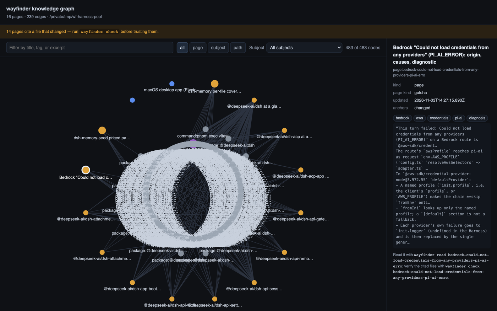

<p align="center">
  <strong>wayfinder</strong><br>
  <sub>A hybrid of a self-generating knowledge graph and the LLM Wiki — written by your agents, read back by the next session.</sub>
</p>

<p align="center">
  <a href="#install">Install</a> &nbsp;·&nbsp;
  <a href="#quickstart">Quickstart</a> &nbsp;·&nbsp;
  <a href="#how-it-works">How it works</a> &nbsp;·&nbsp;
  <a href="#concurrent-agents">Concurrent agents</a> &nbsp;·&nbsp;
  <a href="BENCHMARK.md">Benchmark</a> &nbsp;·&nbsp;
  <a href="CONTRIBUTING.md">Contributing</a>
</p>

<p align="center">
  <a href="https://github.com/zaterka/wayfinder/actions/workflows/ci.yml"></a>
  <a href="LICENSE"></a>
  <a href="Cargo.toml"></a>
</p>



Agents re-derive what they already knew. Wayfinder fixes that at the source: every finding a
session saves becomes a page with a title, a kind, tags, the subjects it is about, and a
fingerprint of every file it cites — and those declarations *are* the graph.

Wayfinder is that hybrid: a wiki with the structure of a graph.

- **The LLM Wiki** — an agent writes what it learned into a wiki it reads next session
  ([Karpathy's gist](https://gist.github.com/karpathy/442a6bf555914893e9891c11519de94f)), with
  section reads, search over declared relations, and a check that says when a cited file moved.
- **A self-generating knowledge graph** — pages, subjects, packages, and cited paths are nodes;
  `about` / `cites` / `depends` / `supersedes` are edges. Nothing to model by hand, no database
  to run: `seed --structure` maps a repository in seconds, and every page an agent saves
  afterwards makes the graph richer.

`wayfinder graph --format html --out graph.html --watch` draws it — and keeps drawing it while
agents work.

## Install

```bash
curl -fsSL https://raw.githubusercontent.com/zaterka/wayfinder/main/scripts/install.sh | bash
```

Installs the released binary for Linux or macOS (arm64 or x86_64) into `~/.local/bin` after
verifying the release checksum. `WAYFINDER_VERSION=v0.1.0` pins a version,
`WAYFINDER_INSTALL_DIR` picks another directory.

From source, if you have the toolchain:

```bash
cargo install --git https://github.com/zaterka/wayfinder wayfinder
```

One binary. No runtime, no daemon, no database server — the index is a SQLite file the store
rebuilds from the pages.

## Quickstart

```bash
wayfinder init                    # create .wayfinder/ in this repository
wayfinder seed --structure        # one page per package, from manifests and READMEs
wayfinder install claude          # MCP server + instructions for your harness
wayfinder graph --format html --out graph.html --open
```

Then start a new session. Your agent can call `memory_search`, `memory_read`, `memory_save`,
`memory_list`, `memory_check`, `memory_digest`, and `memory_graph`, and it has been told when
to use them.

```console
$ wayfinder search "how many requests per second"
1. Rate limits (id: rate-limits, kind: fact, updated 2026-11-03, rev: 890e3bf665eb6756)
   ## Throughput
   The limiter allows 100 requests per second per key.

$ wayfinder read rate-limits --section Throughput
Read memory page "Rate limits" (id: rate-limits, tags: memory, kind: fact, rev: …)

## Throughput
The limiter allows 100 requests per second per key.

$ wayfinder check
Memory page "rate-limits" cites files that changed. Re-read these before trusting the page:
  changed src/limiter.rs (now 3a1a16bbdd29312f)
```

## What it gives you

| | |
|---|---|
| **A graph that writes itself** | Every saved page declares `subject`, `depends`, `anchors`, and `supersedes`; those become nodes and edges. `seed --structure` maps an existing repository without a model. |
| **A wiki built for reuse** | `read --section` returns one heading instead of a page; search ranks with FTS5, then walks one hop over declared relations, so a page that never names the query can still answer it. |
| **A trust check** | Every cited file is fingerprinted at save. `check` reports `fresh` / `changed` / `missing` per anchor, so a session knows whether to trust a page or re-read the file. |
| **Concurrent agents, no corruption** | Atomic writes, a locked index, and content-hash revisions: two agents on one page serialize instead of clobbering, and the loser is told to re-read. See [Concurrent agents](#concurrent-agents). |
| **A dashboard you can click** | `graph --format html` writes one offline file — node details, kind and subject filters, a text filter, a drift banner, cluster counts — and `--watch` keeps it current. |
| **Harness-agnostic** | A terminal-first CLI, an MCP server over stdio, and one-command installs for Claude Code, Codex, Copilot, Cursor, and Gemini CLI. |
| **A pool on day one** | `seed --pages` upgrades the free pointer pages with model-written ones, behind a stated cost and a `--yes` gate. |

## Concurrent agents

Several agents in one repository is the normal case now: parallel subagents, a swarm, a
reviewer writing while an implementer reads. Wayfinder is built for it rather than around it.

- **Atomic page writes.** Every save goes to a temporary file and is renamed into place, so a
  reader never sees a half-written page.
- **A locked index.** The derived index updates under an exclusive cross-process lock, so two
  writers never interleave their rows.
- **Revisions as fences.** `rev` is a hash of the page's bytes. A save carrying
  `--expected-rev` is refused when the page moved, and the refusal names the revision that is
  there now — the writer re-reads and retries instead of silently overwriting a colleague.
- **Different pages never contend.** The lock covers the index update, not the investigation,
  so agents writing different pages proceed in parallel.

Both properties are tested, not asserted: eight writers saving at once all land and are
indexed, and two writers racing one page leave exactly one winner
(`crates/wayfinder-core/tests/core.rs`). Point `wayfinder graph --watch` at the pool to watch a
swarm fill it in.

## Measured

Three cases of an agent benchmark, four surfaces, one agent loop, one model (Qwen 3.8-27B,
self-hosted). Follow-up cost against an agent with **no memory tool**:

| Surface | Wall time | Tokens |
|---|---|---|
| **wayfinder** | **−13 %** | **−30 %** |
| LLM Wiki implemented in-process by the harness | +6 % | +23 % |
| graphify (code graph, queried through the shell) | +13 % | +5 % |

Every follow-up in every arm passed the same ground-truth check. Method, per-case split, and
reproduction steps: [**BENCHMARK.md**](BENCHMARK.md).

## How it works

```
.wayfinder/
├── memory/<id>.md     one page per finding: frontmatter + markdown
├── index.db           derived SQLite (FTS5 + edges); delete it and it rebuilds
└── write.lock         cross-process write lock
```

The page is the durable artifact; the graph and the index are derived from it.

```markdown
---
title: Rate limits
tags: [memory]
kind: fact
subject: [package:gateway, path:src/limiter.rs]
depends: [serde]
anchors:
  - src/limiter.rs
    sha: 3f2a1c4d5e6b7a89
---

## Throughput

The limiter allows 100 requests per second per key.
```

Commit `.wayfinder/memory/` with the repository: the pages are reviewable in a diff, and the
pool outlives the session, the model, and the harness that wrote it. The root resolves as
`--root`, then `WAYFINDER_ROOT`, then the nearest ancestor holding `.wayfinder/` or `.git/`, so
a worktree and its branches share one pool instead of forking it.

## Harnesses

| Harness | MCP entry | Instructions |
|---|---|---|
| `claude` | `.mcp.json` (or `~/.claude.json`) | `CLAUDE.md` |
| `codex` | `~/.codex/config.toml` | `AGENTS.md` |
| `copilot` | `.vscode/mcp.json` | `.github/copilot-instructions.md` |
| `cursor` | `.cursor/mcp.json` | `.cursor/rules/wayfinder.mdc` |
| `gemini` | `.gemini/settings.json` | `GEMINI.md` |
| `agents` | — | `AGENTS.md`, with the CLI commands |

`install` merges instead of replacing: an existing `.mcp.json` keeps its other servers, an
existing `CLAUDE.md` keeps its prose, and the wayfinder block sits between markers so a second
install updates it in place. Nothing listens on a port — the MCP server is a stdio child
process the harness starts and stops.

## Commands

| Command | What it does |
|---|---|
| `wayfinder init` | Create the pool and build its index. |
| `wayfinder save` | Write or merge a page; `--anchor path[:line]` fingerprints a cited file. |
| `wayfinder search "…"` | FTS5 over titles and bodies, then one hop over declared relations. |
| `wayfinder read <id> [--section …]` | One page, or just the heading that matches. |
| `wayfinder list` · `check` | The pool, newest first · verify every cited file. |
| `wayfinder digest` | The block a harness injects so a session knows the pool exists. |
| `wayfinder graph --format …` | `html` (interactive), `svg`, `json`, `dot`, `mermaid`; `--watch`, `--open`. |
| `wayfinder seed --structure` · `--pages` | Free pages from files · model-written pages, plan first. |
| `wayfinder install <harness>` · `mcp` | Wire a harness · serve the pool over MCP. |
| `wayfinder status` · `reindex` | What the pool holds · rebuild the derived index. |

## Documentation

- [BENCHMARK.md](BENCHMARK.md) — what was measured, how, and what it does not prove.
- [PLAN.md](PLAN.md) — the design decisions behind the store, revisions, and the graph.
- [CONTRIBUTING.md](CONTRIBUTING.md) — the checks CI runs and the rules the code keeps.

## License

Apache License 2.0 — see [LICENSE](LICENSE) and [NOTICE](NOTICE). In short: use it, fork it,
ship it in a product, commercial or not; keep the notices and the license text, and if you
sue anyone over a patent in it, your patent grant ends.
